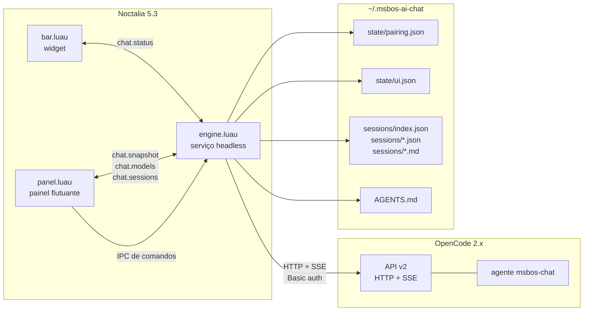
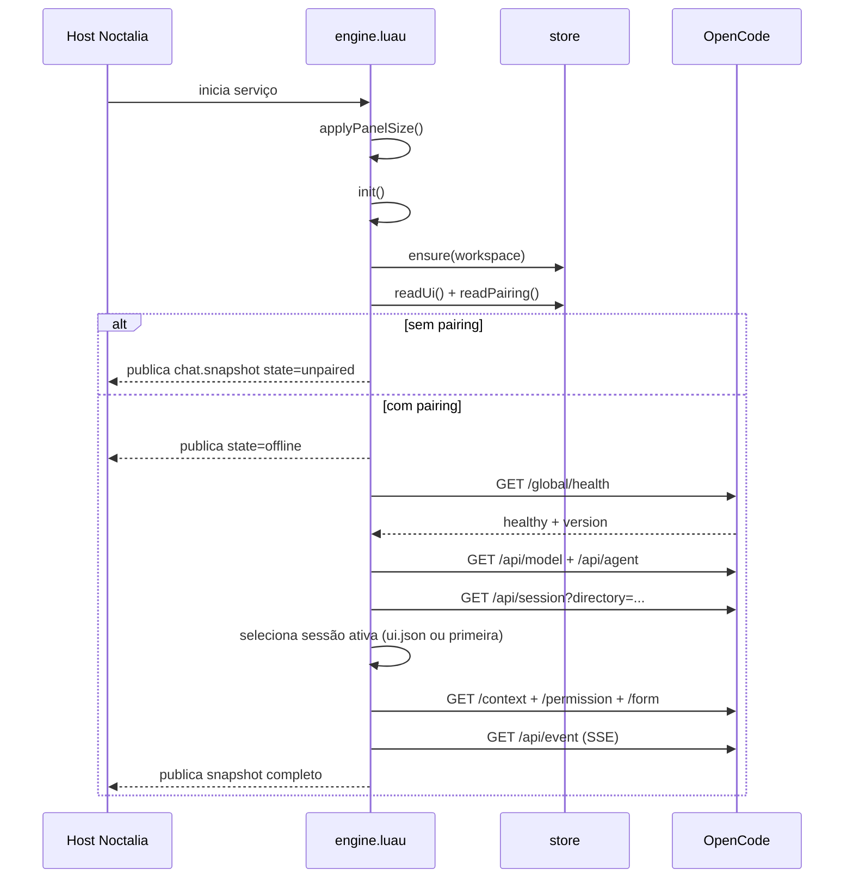
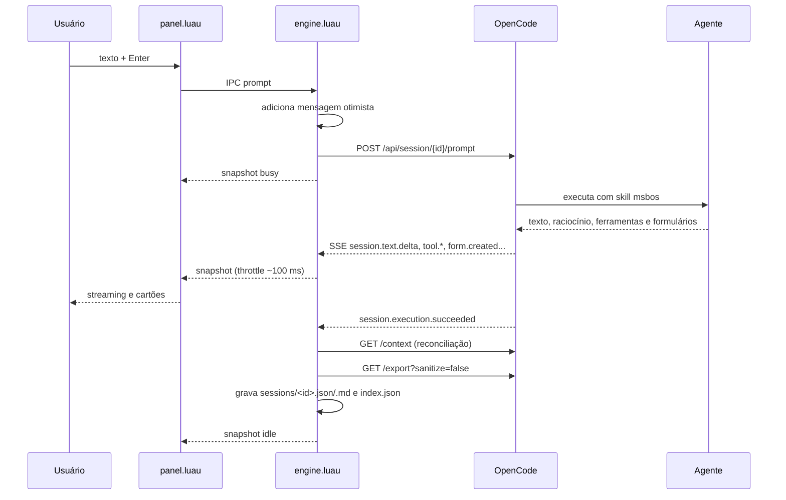
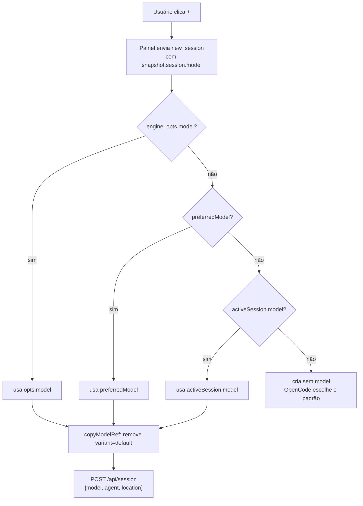

# Arquitetura

## Visão geral

O projeto é um plugin do **Noctalia** com três entradas de runtime e um serviço:

| Entrada | Arquivo | Papel |
|---|---|---|
| Widget de barra | `plugin/bar.luau` | Ícone sempre visível, ponto de status e toggle do painel. |
| Painel | `plugin/panel.luau` | Chat, compositor, mensagens, formulários, seletor de modelo/raciocínio/sessões e onboarding. |
| Serviço | `plugin/engine.luau` | Dono do pareamento, da conexão SSE, do estado da conversa e da persistência. |

O painel **não fala diretamente** com o OpenCode. Ele envia comandos por IPC para o `engine` e lê o estado publicado em `noctalia.state`. A barra também só observa `chat.status` e chama o toggle do painel.

## Componentes e responsabilidades

| Módulo | Responsabilidade |
|---|---|
| `plugin/plugin.toml` | Manifesto: metadados, settings, serviço, widget e painel. |
| `plugin/bar.luau` | Renderiza o ícone, opcionalmente o título, e um ponto de status (`busy`, `unread`, `error`, idle). Clique abre/fecha o painel. |
| `plugin/panel.luau` | Renderiza as telas; mantém rascunho, seleção local, formulários e expansão de cartões; envia comandos ao engine. |
| `plugin/engine.luau` | Inicializa settings e workspace, pareia, lista catálogo/sessões, mantém SSE, aplica eventos, publica snapshots, responde formulários/permissões, exporta e notifica. |
| `plugin/lib/api.luau` | Cliente HTTP/SSE do OpenCode: pair, auth, requests, sessões, permissões, formulários e export. |
| `plugin/lib/store.luau` | Workspace, `AGENTS.md`, `pairing.json`, `ui.json`, exports JSON/Markdown e índice. |
| `plugin/lib/format.luau` | Formatação de modelos (incluindo variante), status de ferramentas, erros, truncamento e tempo relativo. |
| `plugin/translations/*.json` | Labels e descrições dos settings em pt-BR e en. |
| `opencode/agents/msbos-chat.md` | Agente primário que carrega a skill `msbos` e define permissões/limites. |
| `install.sh` / `uninstall.sh` | Instalação/remoção local do plugin, agente e workspace. |

> Evolução em relação ao `MAPEAMENTO.md`: não existe `picker.luau` nem `lib/sse.luau` no código atual. O seletor é uma view de `panel.luau` e o cliente SSE está em `lib/api.luau`.

## Ciclo de vida do serviço

O `engine` roda mesmo com o painel fechado. O painel, ao abrir, define `chat.panel_open = true`, pede `sync` e renderiza o último snapshot. Ao fechar, define `chat.panel_open = false`; a execução e o SSE continuam.

### Atualização de estado

- `publish()` incrementa `revision`, monta o `chat.snapshot` e publica também `chat.status`.
- Eventos de streaming marcam `dirty`; `update()` publica no máximo a cada **100 ms**.
- `noctalia.setUpdateInterval(100)` mantém o loop do serviço.
- O painel observa `chat.snapshot`, `chat.models` e `chat.sessions`; a barra observa `chat.status`.
- Valores de `noctalia.state` são cópias planas; o painel não compartilha referências mutáveis com o engine.

## Fluxo de prompt e streaming

A mensagem do usuário é inserida localmente antes da resposta para feedback imediato. Quando o contexto final chega, a lista é substituída pela versão do OpenCode; os deltas são apenas otimização visual.

## Seleção de sessão e reconciliação

1. `selectSession(id)` encontra a sessão na lista, limpa mensagens/permissões/formulários e publica `idle`.
2. Em paralelo, busca `/context`, `/permission` e `/form`.
3. O contexto é mapeado para mensagens da UI; se a sessão não tiver `model`, o engine tenta o modelo da última mensagem do assistente.
4. Ao terminar uma execução, reconectar o SSE ou abrir o painel, `/context` é consultado novamente.

O contexto é a fonte de verdade; eventos incrementais só evitam esperar o fim para mostrar texto.

## Nova conversa e herança de modelo

- `preferredModel` é atualizado quando `set_model` tem sucesso e é persistido em `state/ui.json`.
- A precedência é: modelo enviado pelo painel → último modelo preferido → modelo da sessão ativa.
- A variante (`low`, `high`, `max` etc.) é preservada; `default` é omitido.
- Conversas existentes mantêm o modelo que já tinham.

## Tamanho do painel

O Noctalia é dono do tamanho do painel; não há API de redimensionamento em runtime. O plugin usa três presets:

| Preset | Dimensões |
|---|---|
| `compact` | 420 × 560 |
| `medium` | 460 × 640 (padrão) |
| `large` | 620 × 820 |

Quando o setting `panel_size` muda, o engine reescreve `width`/`height` da primeira seção `[[panel]]` do `plugin.toml` **instalado**, cria `plugin.toml.bak-size` e agenda `plugins disable` + `plugins enable` para o host reler o manifesto.

## Permissões e formulários

O agente atual tem `edit: allow`, `shell: allow`, `question: allow` e `task: deny`. O engine também responde automaticamente a `permission.asked`:

- `shell`, `edit`, `question` e `form` → `once`;
- qualquer outra ação → `reject` (com notificação).

Assim, **não há cartão técnico de permissão** para shell/edit nesta versão. A confirmação de mudanças é conversacional, feita pelo ritual da skill `msbos`. Veja [Segurança](seguranca.md).

Formulários da ferramenta `question` chegam por `form.created` com o `sessionID` dentro de `data.form`; o engine trata esse evento antes do filtro de sessão para não descartá-lo. O painel renderiza os campos e envia `reply_form`.

## Decisões de arquitetura

| Decisão | Efeito |
|---|---|
| Plugin do Noctalia em vez de app separado | Integração nativa com barra e painel layer-shell; sem gerenciamento de janela do niri. |
| Engine como fonte de verdade | Respostas continuam com o painel fechado; barra reflete estado; uma única conexão de dados. |
| IPC via CLI + estado compartilhado | Simples e isolado por VM, mas payload é argumento de linha de comando e a comunicação é assíncrona. |
| SSE + `/context` | Streaming em tempo real com reconciliação no fim/reconexão. |
| Fundo do painel desenhado pelo host | Evita o efeito de painel duplicado; o frame do plugin é transparente. |
| Permissões automáticas | Menos atrito para o assistente de desktop, mas a barreira técnica de shell/edit não é usada. |
| Exports `sanitize=false` | Preserva o texto real para consulta local; arquivos ficam `0600`. |

## Limitações conhecidas

- Sem anexos de arquivo/imagem no compositor.
- Sem múltiplos painéis simultâneos.
- Sem cartão de permissão para shell/edit.
- Formulários não implementam resposta livre (`custom`), campos condicionais (`when`), `hidden`, `required` ou `external`.
- Sem testes automatizados.
- O SSE pode manter mais de uma conexão durante recargas do plugin; o código usa geração para ignorar streams antigos, mas o tema não foi investigado a fundo.
