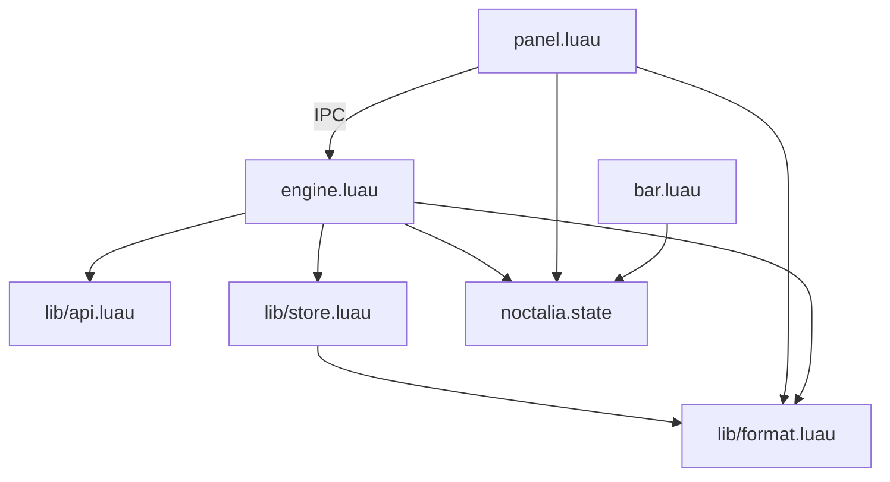

# Componentes e módulos

## Estrutura de arquivos

```text
omyfedora-ai-chat/
├── README.md
├── MAPEAMENTO.md
├── install.sh
├── uninstall.sh
├── opencode/
│   └── agents/omyfedora-chat.md
├── plugin/
│   ├── plugin.toml
│   ├── bar.luau
│   ├── panel.luau
│   ├── engine.luau
│   ├── lib/
│   │   ├── api.luau
│   │   ├── store.luau
│   │   └── format.luau
│   └── translations/
│       ├── pt-BR.json
│       └── en.json
└── docs/
```

Não existem `picker.luau` nem `lib/sse.luau` na implementação atual: o seletor é uma view de `panel.luau` e o SSE é implementado em `lib/api.luau`.

## Dependências



- `bar.luau` não importa módulos.
- `panel.luau` importa apenas `format`.
- `engine.luau` é o único que fala com a rede.
- `store.luau` importa `format` para o Markdown exportado.
- As três entradas compartilham estado via `noctalia.state` e comandos via IPC.

## Manifesto — `plugin/plugin.toml`

| Item | Valor |
|---|---|
| `id` | `omyfedora/ai-chat` |
| `version` | `0.1.0` |
| `plugin_api` | `34` |
| Entradas | serviço `engine`, widget `bar`, painel `panel` |
| Painel | `460 × 640`, `floating`, `top_right`, `overlay`, `dismiss_on_outside_click = false`, `persistent = false` |
| Settings | `directory`, `agent`, `opencode_bin`, `auto_pair`, `auto_export`, `notify_on_finish`, `show_bar_label`, `max_tool_output`, `panel_size` |
| Setting do widget | `glyph` |

As labels traduzidas ficam em `plugin/translations/pt-BR.json` e `en.json`.

## `bar.luau` — widget da barra

| Função/comportamento | Descrição |
|---|---|
| `render()` | Monta glifo + ponto de status + título opcional. |
| `update()` | Ajusta o intervalo de atualização (`500 ms` busy, `5000 ms` idle). |
| `onClick()` | `noctalia.togglePanel("omyfedora/ai-chat:panel")`. |
| `onConfigChanged()` | Re-renderiza ao mudar `glyph`/`show_bar_label`. |
| Watch de `chat.status` | Atualiza o ponto e o título. |

Prioridade das cores do ponto:

1. `busy` → `primary`
2. `unread` → `tertiary`
3. `state == "error"` → `error`
4. caso contrário → `outline`

O widget respeita orientação vertical/horizontal da barra.

## `panel.luau` — painel e seletor

### Estado local

| Variável | Uso |
|---|---|
| `isOpen` | Painel aberto/fechado no runtime atual. |
| `snapshot` | Cópia de `chat.snapshot`. |
| `composerKey` | Muda a key do input para limpar após envio. |
| `draft` | Rascunho do compositor. |
| `pairLinkDraft` | Link colado no onboarding. |
| `toast` / `toastAt` | Erros transitórios por 5 s. |
| `expandedTools` / `expandedReasoning` | Expansão de cartões. |
| `formDrafts` | Respostas em edição por `form.id`. |
| `view` | `"chat"` ou `"picker"`. |
| `models` / `sessions` | Cópias de `chat.models`/`chat.sessions`. |
| `selectedModelIndex` / `selectedSessionIndex` | Seleção local (1-based). |
| `selectedReasoningId` | Variante selecionada; `"default"` por padrão. |
| `deleteConfirm` | ID da sessão aguardando confirmação. |
| `spinnerFrames` / `spinnerFrame` / `spinnerAccum` | Animação do indicador de “Pensando…”. |

### Funções principais

| Função | Papel |
|---|---|
| `sendCommand(event, payload)` | Executa `noctalia msg plugin omyfedora/ai-chat:engine all <event> [payload]` via `runAsync` com argv. |
| `header()` | Título, subtítulo, botões novo/histórico/minimizar. |
| `renderTool(tool)` | Cartão de ferramenta expansível. |
| `renderForm(form)` | Formulário com toggle, opções e input; envia `reply_form`. |
| `renderMessage(message)` | Bolha do usuário, mensagem do assistente, raciocínio, tools e erro. |
| `composer()` | Input multiline, rodapé com agente/modelo e botão enviar/parar. |
| `chatView()` | Lista de mensagens, formulários, aviso/erro, agente ausente e compositor. |
| `onboardingView()` | Conexão automática, link, colar, copiar comando, abrir terminal. |
| `offlineView()` | Tentar novamente e abrir terminal. |
| `pairingView()` | Estado de pareamento em andamento. |
| `pickerView()` | Seletor de modelo/raciocínio e lista de sessões. |
| `frame(content)` | Container transparente; o host desenha fundo/borda. |
| `render()` | Escolhe a view e chama `panel.render`. |
| `onOpen` / `onClose` | Ciclo de vida; publica `chat.panel_open`; liga/desliga frame ticks. |
| `onFrameTick(deltaMs)` | Anima o spinner a cada ~120 ms quando busy. |
| `onNewSession()` | Envia `new_session` com o modelo atual. |
| `onConfirmDelete()` | Envia `delete_session` e permanece no seletor. |
| `onSend` / `onSubmit` | Envia `prompt` e limpa o compositor. |
| `onStop()` | Envia `interrupt`. |
| `onPairAuto` / `onPairLinkSubmit` / `onPastePairLink` | Pareamento. |
| `onOpenSettings()` | Abre Settings do Noctalia. |
| `syncPickerSelection()` | Sincroniza seleção com a sessão/modelo ativos. |
| `applySelectedModel()` | Envia `set_model` com `id`, `providerID` e variante (se não-default). |

### IPC recebido pelo painel

| Evento | Efeito |
|---|---|
| `refresh` | Re-renderiza. |
| `open_picker` | Abre a view do seletor. |
| `back` | Volta ao chat. |

Exemplo:

```bash
noctalia msg plugin omyfedora/ai-chat:panel all open_picker
```

## `engine.luau` — serviço

### Blocos

| Bloco | Responsabilidade |
|---|---|
| Configuração/estado | Settings, pairing, modelos, agentes, sessões, mensagens, pendências, flags de status. |
| `publish()` | Monta `chat.snapshot`/`chat.status`, incrementa `revision`. |
| `loadCatalog()` | Modelos/agentes; filtra e publica. |
| `loadSessions()` | Lista sessões, escolhe a ativa e chama `selectSession`. |
| `selectSession()` | Limpa estado, busca contexto/permissões/formulários. |
| `createSession()` | Cria sessão com modelo herdado e agente configurado. |
| `sendPrompt()` / `sendPromptTo()` | Mensagem otimista, rename do primeiro prompt, `POST /prompt`. |
| `setModel()` / `setAgent()` | Troca modelo/agente da sessão ativa; `setModel` atualiza `preferredModel`. |
| `deleteSession()` | Remove no OpenCode; se era a ativa, limpa a sessão ativa e mantém o painel no seletor. |
| `replyPermission()` / `replyForm()` | Responde pendências. |
| `handleEvent()` | Aplica eventos SSE. |
| `connectSse()` | Abre/reabre o stream e agenda backoff. |
| `checkHealth()` | Health, catálogo, sessões e SSE. |
| `doPair()` / `onPaired()` | Pareamento automático/manual. |
| `applyPanelSize()` | Reescreve o manifesto instalado e recarrega. |
| `init()` | Reinicializa todo o estado a partir de settings/disco. |
| `onIpc()` | Comandos do painel/CLI. |
| `update()` | Publicação com throttle, reconexão e health periódico. |
| `onEnable` / `onConfigChanged` / `onExit` | Ciclo de vida do serviço. |

### IPC recebido pelo engine

| Evento | Payload | Ação |
|---|---|---|
| `sync` | — | Republica snapshot/modelos/sessões; se offline, health check. |
| `pair` | link ou vazio | Pareia com link ou executa `opencode pair`. |
| `unpair` | — | Para SSE e apaga `pairing.json`. |
| `new_session` | JSON `{ model?, agent? }` | Cria sessão. |
| `select_session` | ID | Carrega sessão. |
| `delete_session` | ID | Apaga sessão no OpenCode. |
| `set_model` | JSON `Model.Ref` | Troca modelo/variante da sessão ativa. |
| `set_agent` | ID | Troca agente da sessão ativa (sem UI dedicada). |
| `prompt` | texto | Envia mensagem; cria sessão se não houver ativa. |
| `interrupt` | — | Interrompe execução. |
| `reply_permission` | JSON `{ requestID, decision }` | Responde permissão. |
| `reply_form` | JSON `{ formID, answer }` | Responde formulário. |
| `refresh_models` | — | Recarrega catálogo. |
| `refresh_sessions` | — | Recarrega sessões. |
| `export` | ID ou vazio | Exporta a sessão ativa/indicada. |
| `toggle_panel` | — | Alterna o painel pelo host. |

> `reply_permission` existe no IPC, mas o painel atual não renderiza cartões de permissão; o engine responde `permission.asked` automaticamente.

## `lib/api.luau` — cliente OpenCode

| Função | Chamada |
|---|---|
| `parsePairLink(link)` | Valida e extrai `baseUrl`/`code`. |
| `pair(link, cb)` | `GET /auth/connect/{code}`. |
| `request(pairing, method, path, body, cb, opts)` | HTTP com Basic auth e `directory`. |
| `errorMessage(err)` | Normaliza erros. |
| `health(baseUrl, cb)` | `GET /global/health`. |
| `listModels` | `GET /api/model`. |
| `defaultModel` | `GET /api/model/default` (não usado). |
| `listAgents` | `GET /api/agent`. |
| `listSessions` | `GET /api/session?limit=50&order=desc`. |
| `createSession` | `POST /api/session`. |
| `context` | `GET /api/session/{id}/context`. |
| `prompt` | `POST /api/session/{id}/prompt`. |
| `interrupt` | `POST /api/session/{id}/interrupt`. |
| `setModel` | `POST /api/session/{id}/model`. |
| `setAgent` | `POST /api/session/{id}/agent`. |
| `renameSession` | `PATCH /api/session/{id}`. |
| `deleteSession` | `DELETE /api/session/{id}`. |
| `listPermissions` | `GET /api/session/{id}/permission`. |
| `replyPermission` | `POST .../permission/{requestID}/reply`. |
| `listForms` | `GET /api/session/{id}/form`. |
| `replyForm` | `POST .../form/{formID}/reply`. |
| `exportSession` | `GET /api/experimental/session/{id}/export?sanitize=false`. |
| `streamEvents` | `GET /api/event` (SSE). |

O cliente não tem retry HTTP genérico; o tratamento de reconexão é específico do SSE e do health check.

## `lib/store.luau` — persistência

| Função | Papel |
|---|---|
| `ensure(directory)` | Cria workspace/`state`/`sessions` e `AGENTS.md` se faltar. |
| `paths(directory)` | Caminhos de root, state, sessions, pairing, ui e index. |
| `readJson` / `writeJson` | JSON com opção de `chmod`. |
| `readPairing` / `writePairing` / `clearPairing` | Credencial de pareamento. |
| `readUi` / `writeUi` | Sessão ativa, modelo, `preferredModel`, agente. |
| `sessionMarkdown(data, maxToolOutput)` | Transcrição legível. |
| `writeSession(directory, id, data, maxToolOutput)` | Grava JSON/MD, atualiza `index.json`. |

## `lib/format.luau` — formatação

| Função | Uso |
|---|---|
| `truncate(text, max)` | Trunca saídas e adiciona “(truncado)”. |
| `toolInput(input)` | Serializa/trunca entrada de ferramenta (1200). |
| `errorText(err)` | Extrai mensagem de erros variados. |
| `modelLabel(model)` | `provider/id · variante` (omite `default`). |
| `toolStatusLabel(status)` | `ok`, `erro`, `executando`, `preparando`. |
| `toolGlyph(name)` | Ícone Tabler por ferramenta. |
| `timeAgo(ms)` | `agora`, `Nm`, `Nh`, `Nd`. |

## Agente — `opencode/agents/omyfedora-chat.md`

- `mode: primary`, `temperature: 0.2`.
- Permissões: `edit: allow`, `shell: allow`, `read: allow`, `webfetch: allow`, `skill: allow`, `question: allow`, `task: deny`.
- Instruções: carregar a skill `omyfedora`, pedir confirmação, backup, aplicar, validar, diff e log.
- Limites: sem `sudo`, root apenas via `pkexec`, arquivos protegidos, sem senhas, conteúdo externo é dado.
- Como o shell do OpenCode Desktop roda com `NoNewPrivs=1`, o agente aciona o helper com `niri msg action spawn -- alacritty -e /usr/bin/pkexec ...`, localiza/foca a janela do polkit e valida depois com leitura.
- Usa a ferramenta `question` para decisões com opções.

## Scripts

| Script | Comportamento |
|---|---|
| `install.sh` | Copia plugin/agente, cria workspace, lint e tenta habilitar. |
| `uninstall.sh` | Desabilita/remove plugin, move agente para backup, preserva workspace; `--purge` apaga o workspace. |

## Convenções

- Luau com `--!nonstrict`.
- UI declarativa (`ui.row`, `ui.column`, `ui.button`, `ui.select`, `ui.input`, `ui.scroll`).
- Callbacks de UI podem ser closures ou nomes de funções globais.
- O engine usa `generation`/`streamGeneration` para descartar callbacks de configurações recarregadas.
- O painel nunca bloqueia; toda chamada externa é via IPC assíncrono.
