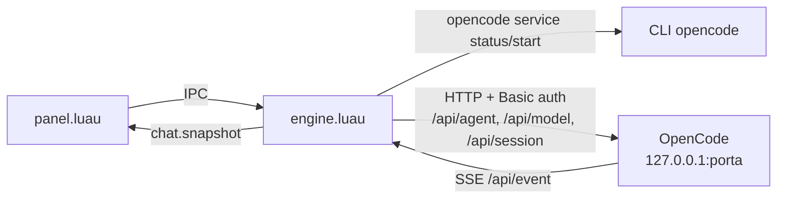
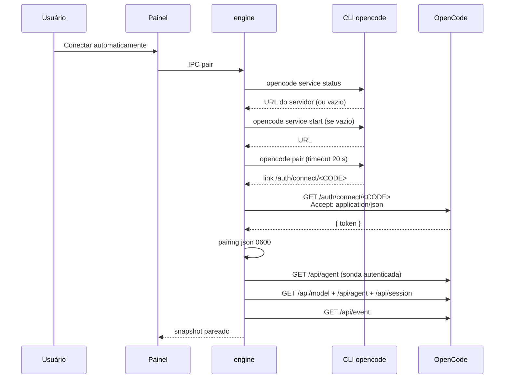
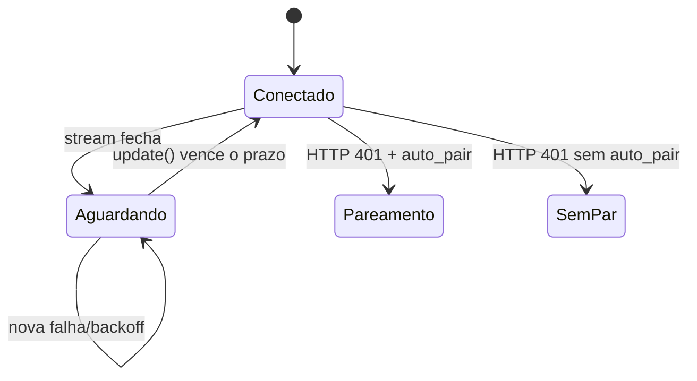

# Conexão com o OpenCode

## Visão geral

O plugin conversa com o servidor local do OpenCode pela **API v2**, usando HTTP para comandos e SSE para eventos. O endereço vem do link de pareamento; não há URL fixa no código.



O plugin **inicia o servidor do OpenCode por conta própria**: no boot (e sempre que o estado voltar a `offline`) o engine executa `opencode service status`; se não houver servidor, `opencode service start`, e adota a URL devolvida pelo CLI. Assim o chat conecta sem depender do app desktop ou de um terminal. Enquanto isso, o painel mostra o estado `starting`.

O `service start` é disparado pelo processo do Noctalia, então o servidor herda o ambiente da sessão gráfica (`WAYLAND_DISPLAY`, `NIRI_SOCKET`, `PATH`), o que mantém as ferramentas `niri` do agente funcionando.

## Pareamento

### Automático

1. Sem `state/pairing.json` e com `auto_pair = true`, o engine pareia sozinho no `init()` e repete a cada **15 s** enquanto o estado for `unpaired`. O botão **Conectar automaticamente** (IPC `pair` sem payload) faz o mesmo na hora.
2. O engine garante o servidor: `opencode service status`; se necessário, `opencode service start` (timeout de **20 s**). A URL devolvida é adotada como `baseUrl`.
3. O engine executa `opencode pair` com timeout de **20 s**.
4. O stdout é lido com a expressão `https?://.../auth/connect/<código>`.
5. O engine faz `GET <baseUrl>/auth/connect/<código>` com `Accept: application/json`.
6. O servidor devolve `{ "token": "..." }`.
7. O engine grava `state/pairing.json` com `baseUrl`, `token`, `version` e `pairedAt`; o arquivo é gravado com modo `0600`.
8. Em seguida faz a sonda autenticada em `/api/agent`, carrega modelos/sessões e abre o SSE.



### Link colado

O painel também aceita um link completo. O engine valida o formato, extrai a origem (`http://host:porta`) e o código, e faz a mesma chamada. Isso permite usar um túnel SSH ou um servidor remoto conscientemente; o token continua sendo uma credencial de portadora.

O código do link **não é persistido**: apenas o token e a `baseUrl`.

### Expiração e reutilização

O link do `opencode pair` é de uso único e expira em poucos minutos (comportamento do servidor OpenCode; a referência é 5 minutos). Se o pareamento falhar com `401`, a mensagem orienta a rodar `opencode pair` novamente.

### Re-pareamento em `401`

Quando o SSE cai com `401` e `auto_pair = true`, o engine chama `doPair("")` para obter um novo link. O mesmo acontece quando a sonda autenticada (`/api/agent`) devolve `401`. Se `auto_pair` estiver desligado, o estado volta para `unpaired` e o onboarding é exibido.

## Autenticação

Todas as chamadas de dados usam **Basic auth** com:

```text
usuário: opencode
senha:   <token>
```

No cliente, isso é configurado como `basic_username = "opencode"` e `basic_password = pairing.token`. O token não aparece em logs nem no snapshot.

## Conexão, sonda e recuperação

O engine não usa `/global/health`: ele não exige autenticação e, no OpenCode v2, responde com o HTML da SPA (HTTP 200) mesmo quando não é o endpoint de saúde. A sonda real é **`GET /api/agent`** com Basic auth — ela valida servidor **e** token em uma chamada.

| Situação | Comportamento |
|---|---|
| `init()` com pairing | estado `starting`; `ensureService()` |
| `ensureService()` | `opencode service status`; se vazio, `opencode service start`; adota a URL devolvida em `pairing.baseUrl` (persistida) |
| Sonda OK | estado `idle`; carrega catálogo/agentes/sessões; abre o SSE |
| Sonda `401` | re-pareia (`auto_pair`) ou estado `unpaired` |
| Sonda falha (rede) | estado `offline`, erro “OpenCode não está respondendo.” |
| Retry automático | `offline` → `ensureService()` com backoff de 5 s a 60 s |
| `sync` no painel | se `offline`, chama `ensureService()`; se não pareado, tenta parear; senão republica e revalida agentes |
| `onEnable` | `ensureService()` se existe pairing e o estado não é `idle` |
| Servidor trocou de porta | `service status` devolve a URL atual e o engine reescreve `pairing.json` |
| Sem pairing + `auto_pair` | pareia automaticamente; o IPC `unpair` suspende o loop até um `pair`/`start` explícito |

## Escopo por diretório

O banco do OpenCode é global, mas o plugin usa o parâmetro `directory` para escopar as sessões ao workspace do chat:

- `GET /api/session?directory=<workspace>&limit=50&order=desc`
- `POST /api/session` com `location = { directory = <workspace> }`
- demais operações de sessão também recebem `?directory=<workspace>`

O cliente adiciona `directory` automaticamente às requisições que recebem `opts.directory` (todas as operações de sessão, permissão, formulário, modelo/agente da sessão e export). As listas de **modelos** e **agentes** são globais e não recebem esse parâmetro.

O workspace é `~/.omyfedora-ai-chat` por padrão, configurável em **Settings → Plugins**. O banco autoritativo continua em `~/.local/share/opencode/opencode.db`; o plugin espelha as conversas em `sessions/`.

## SSE (eventos em tempo real)

| Item | Comportamento |
|---|---|
| Endpoint | `GET /api/event` |
| Headers | `Accept: text/event-stream` + Basic auth |
| Parser | linhas `data: {json}`; ignora vazias e comentários; usa `event.type` e `event.data` |
| Escopo | sem `directory`; o engine filtra eventos pela sessão ativa |
| Envelope | `{ id, created, type, location, data }` |

```text
data: {"id":"evt_...","created":1792625451332,"type":"session.text.delta","location":{"directory":"..."},"data":{"sessionID":"ses_...","assistantMessageID":"msg_...","delta":"..."}}
```

Eventos de formulário são uma exceção importante: o `sessionID` pode estar em `data.form.sessionID`, não em `data.sessionID`. O engine trata `form.created` **antes** do filtro de sessão.

### Reconexão



- Backoff: `min(30, 2^tentativa)` segundos — 1, 2, 4, 8, 16, 30.
- A tentativa é zerada quando o stream é criado com sucesso.
- Um `streamGeneration` descarta callbacks de conexões antigas após recarregar o plugin.
- **Não há replay de eventos** nem `Last-Event-ID`. A reconciliação acontece ao selecionar uma sessão e ao final de uma execução (`/context`); após uma queda longa, o usuário pode reabrir/selecionar a sessão para forçar a leitura do contexto.
- O health check de recuperação (`offline` → `ensureService` → sonda) recarrega sessões e, com isso, o contexto da sessão ativa.

## Descoberta de modelos, agentes e sessões

| Passo | Chamada | Uso |
|---|---|---|
| 1 | `GET /api/model` | Lista global; o engine mantém apenas `enabled != false` e `status != "deprecated"`, e publica `variants[].id`. |
| 2 | `GET /api/agent` | Lista global; ignora subagentes/ocultos e detecta se `omyfedora-chat` existe (`agentStatus = ok \| missing \| unknown`). Serve também como sonda autenticada. |
| 3 | `GET /api/session?limit=50&order=desc&directory=...` | Lista as sessões do workspace. |
| 4 | `GET /api/session/{id}/context` | Mensagens da sessão ativa. |
| 5 | `GET /api/session/{id}/permission` e `/form` | Itens pendentes ao selecionar a sessão. |

A listagem de agentes é revalidada: 3 tentativas a cada 2 s em caso de erro de rede; enquanto o agente estiver ausente, nova consulta em 5 s, 10 s, 20 s, 40 s e depois a cada 60 s; e em cada `sync` do painel (`agentStatus ~= ok`). Isso cobre o servidor recém-iniciado, que pode listar só os agentes embutidos por alguns instantes.

## Tratamento de falhas de transporte

| Situação | Resultado |
|---|---|
| Sem pairing | Erro “OpenCode não está pareado.” / “Conecte o OpenCode primeiro.” |
| `res` nulo | “Sem resposta do OpenCode.” |
| `204` | Sucesso sem corpo (`true`). |
| `2xx` com JSON | Devolve o objeto decodificado. |
| `2xx` vazio | Devolve `true`. |
| `4xx`/`5xx` | Objeto `{ status, message }`; a mensagem tenta `message`, `error`, `error.message` ou `_tag`. |
| `401` na sonda ou no SSE | Re-pareia ou volta para `unpaired`. |
| `opencode` ausente | “Binário não encontrado: …”; ajuste `opencode_bin` ou o `PATH`. |
| `opencode service start` falha | estado `offline` com o `stderr` do CLI; o painel oferece **Iniciar OpenCode** e **Abrir terminal**. |
| `opencode pair` falha | Mostra `stderr` ou “`opencode pair` falhou.” |
| Link inválido | “Link inválido. Cole o link completo exibido por `opencode pair`.” |

## Cuidados

- Mantenha o servidor em loopback; não exponha a porta publicamente.
- Trate o token como senha: o arquivo fica `0600`, mas qualquer processo do mesmo usuário pode lê-lo.
- Um link remoto colado desloca o tráfego para aquele host; use apenas em túnel confiável.
- `sanitize=false` no export preserva o texto real; os arquivos exportados também ficam `0600`.
