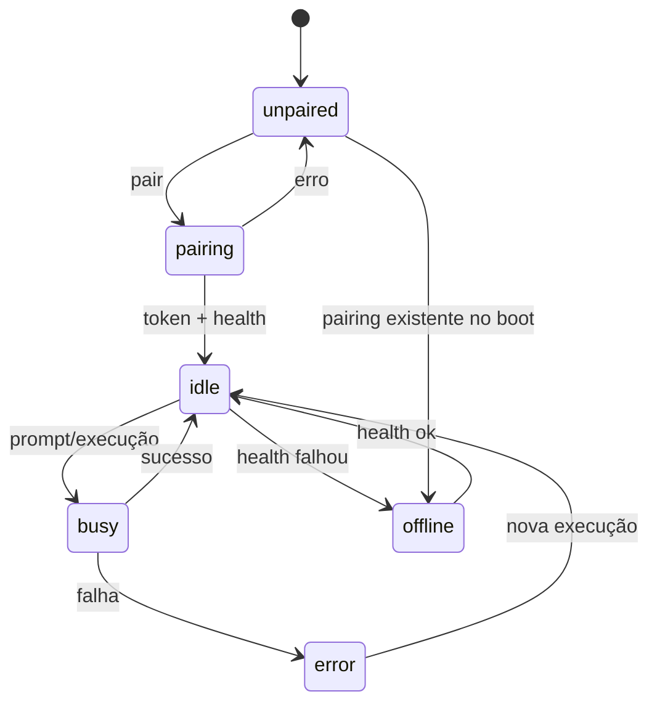

# Estado e persistência

## Quem escreve o quê

| Canal/arquivo | Produtor | Consumidores |
|---|---|---|
| `chat.snapshot` | `engine.luau` | `panel.luau` |
| `chat.status` | `engine.luau` | `bar.luau` |
| `chat.models` | `engine.luau` | `panel.luau` (seletor) |
| `chat.sessions` | `engine.luau` | `panel.luau` (seletor) |
| `chat.panel_open` | `panel.luau` | `engine.luau` |
| `state/pairing.json` | `engine.luau`/`store.luau` | `engine.luau` |
| `state/ui.json` | `engine.luau`/`store.luau` | `engine.luau` |
| `sessions/*` | `engine.luau`/`store.luau` | usuário e auditoria local |

O painel **não** muta o snapshot diretamente. Toda ação passa por IPC; o engine altera o estado e publica uma nova cópia.

## `chat.snapshot`

```lua
{
  revision = 42,
  state = "idle",              -- unpaired | pairing | offline | idle | busy | error
  notice = "",                 -- aviso transitório (ex.: retry)
  error = "",                  -- erro atual
  baseUrl = "http://127.0.0.1:49374",
  agentMissing = false,
  session = {
    id = "ses_...",
    title = "Ajuste do gap do niri",
    model = { id = "...", providerID = "...", variant = "low" },
    agent = "omyfedora-chat",
  },
  messages = { ... },          -- no máximo MAX_SNAPSHOT_MESSAGES (24)
  messagesTotal = 40,          -- tamanho real do histórico interno
  pending = {
    permissions = { ... },
    forms = { ... },
  },
  lastEventAt = 1792625451332,
}
```

| Campo | Tipo | Descrição |
|---|---|---|
| `revision` | number | Incrementa a cada `publish()`. |
| `state` | string | Estado global do serviço. |
| `notice` | string | Aviso não fatal (retry, status). |
| `error` | string | Erro atual. |
| `baseUrl` | string | Origem do OpenCode; nunca inclui o token. |
| `agentMissing` | bool | `true` se o agente configurado não aparece em `/api/agent`. |
| `session` | table/nil | Sessão ativa. |
| `messages` | array | Mensagens mapeadas para a UI (apenas as últimas `MAX_SNAPSHOT_MESSAGES`, 24). |
| `messagesTotal` | number | Total de mensagens no histórico interno; o painel avisa quando é maior que `#messages`. |
| `pending.permissions` | array | Permissões carregadas por `/permission`; **não renderizadas** pelo painel atual. |
| `pending.forms` | array | Formulários pendentes; renderizados no fim do chat. |
| `lastEventAt` | number | `noctalia.nowMs()` da última publicação. |

### Limites de publicação

O snapshot é copiado para o estado compartilhado e reconstruído pelo painel a cada mudança. Para não estourar o orçamento de CPU dos callbacks Luau do Noctalia (que desabilita o painel após timeouts repetidos), `publish()` envia somente as últimas `MAX_SNAPSHOT_MESSAGES` (24) mensagens, dentro de um orçamento total de `MAX_SNAPSHOT_BYTES` (48000): começa pela mensagem mais recente e para de acumular quando o orçamento estoura. Por mensagem, `text` é truncado em `MAX_SNAPSHOT_TEXT` (8000), `reasoning` em `MAX_SNAPSHOT_REASONING` (3000) e `output` de ferramenta em `MAX_SNAPSHOT_TOOL_OUTPUT` (2000). Durante o streaming, o engine publica no máximo a cada `PUBLISH_INTERVAL_MS` (250 ms); eventos pontuais (sessão, permissões, formulários) continuam publicando na hora.

O histórico completo permanece em `messages` dentro do engine. A exportação e o espelho em `sessions/` usam o payload de `/export`, então não sofrem esses cortes.

### Mensagem

```lua
{
  id = "msg_...",              -- ou "local-<timestamp>" para a mensagem otimista
  role = "user" | "assistant",
  text = "...",                -- truncado em MAX_SNAPSHOT_TEXT (8000)
  reasoning = "...",           -- assistente; truncado em MAX_SNAPSHOT_REASONING (3000)
  tools = { ... },             -- assistente
  streaming = false,           -- assistente
  error = "",                  -- assistente
  model = { ... },             -- assistente (vindo do contexto)
}
```

### Ferramenta

```lua
{
  id = "tool_...",
  name = "read",
  status = "running" | "streaming" | "ok" | "completed" | "error",
  input = { ... } | "...",     -- no snapshot vai já formatado/truncado (1200)
  output = "...",              -- truncado em MAX_SNAPSHOT_TOOL_OUTPUT (2000)
}
```

O snapshot não copia `metadata` da ferramenta; ele existe só no histórico interno do engine.

### Formulário pendente

```lua
{
  id = "form_...",
  title = "Questions",
  fields = {
    {
      key = "q0",
      title = "...",
      description = "...",
      type = "string" | "multiselect" | "boolean" | "number" | "integer" | "external",
      options = { { value = "...", label = "...", description = "..." } },
      default = "...",
      placeholder = "...",
      custom = true,
    },
  },
  metadata = { kind = "question" },
}
```

O campo `sessionID` do formulário não é copiado para o snapshot; ele é usado só para o filtro de sessão.

## `chat.status`

```lua
{
  state = "idle",
  busy = false,
  unread = false,
  title = "Ajuste do gap do niri",
  model = "opencode-go/deepseek-v4.1-flash · low",
  error = "",
}
```

| Campo | Uso |
|---|---|
| `state` | Cor/estado conceitual da barra e do painel. |
| `busy` | Ponto `primary` e intervalo de update de 500 ms. |
| `unread` | Ponto `tertiary` quando uma resposta termina com o painel fechado. |
| `title` | Label opcional na barra (`show_bar_label`). |
| `model` | Label formatado do modelo ativo. |
| `error` | Ponto `error` quando não há busy/unread. |

## `chat.models`

```lua
{
  {
    id = "deepseek-v4.1-flash",
    providerID = "opencode-go",
    name = "DeepSeek V4.1 Flash",
    variants = { { id = "low" }, { id = "high" } },
  },
  ...
}
```

O engine filtra modelos com `enabled == false` ou `status == "deprecated"`.

## `chat.sessions`

```lua
{
  {
    id = "ses_...",
    title = "Ajuste do gap do niri",
    updatedAt = 1792625451332,
    model = { id = "...", providerID = "...", variant = "low" },
    agent = "omyfedora-chat",
  },
  ...
}
```

Lista limitada a 50, ordenada por atualização decrescente.

## `chat.panel_open`

| Valor | Significado |
|---|---|
| `true` | Painel aberto; respostas não geram notificação de “painel fechado”. |
| `false`/ausente | Painel fechado; `finishRun` pode marcar `unread` e notificar. |

O engine observa essa chave para decidir notificações e unread.

## Persistência em disco

### `state/pairing.json` (`0600`)

```json
{
  "baseUrl": "http://127.0.0.1:49374",
  "token": "<token>",
  "version": "2.1.2",
  "pairedAt": 1792625451332
}
```

- `token` é a senha do Basic auth.
- `version` é atualizada pelo health check.
- O código do link de pareamento não é salvo.

### `state/ui.json` (`0600`)

```json
{
  "activeSessionID": "ses_...",
  "model": { "id": "deepseek-v4.1-flash", "providerID": "opencode-go", "variant": "low" },
  "preferredModel": { "id": "deepseek-v4.1-flash", "providerID": "opencode-go", "variant": "low" },
  "agent": "omyfedora-chat",
  "lastOpenedAt": 1792625451332
}
```

- `activeSessionID`: última sessão selecionada.
- `model`: modelo da sessão ativa no momento da última gravação.
- `preferredModel`: último modelo definido explicitamente por `set_model`; usado em novas conversas.
- `agent`: agente configurado no momento da gravação (não é lido no `init`; a fonte é o setting).
- O `init` lê `preferredModel` e, se ausente, `model`.

### `sessions/index.json` (`0600`)

```json
{
  "sessions": [
    {
      "id": "ses_...",
      "title": "Ajuste do gap do niri",
      "updatedAt": 1792625451332,
      "model": { "id": "...", "providerID": "...", "variant": "low" },
      "agent": "omyfedora-chat",
      "messageCount": 12
    }
  ]
}
```

### `sessions/<id>.json` e `.md`

- O JSON é o payload completo de `GET /export?sanitize=false` (`{ info, messages }`).
- O Markdown contém título, ID, agente, modelo, data, mensagens do usuário, texto/raciocínio do assistente e ferramentas.
- O texto de raciocínio/saída de ferramenta é truncado por `max_tool_output`; a entrada de ferramenta em 1200 caracteres.
- Ambos são gravados com `0600`.

### `AGENTS.md`

Criado se não existir, com as regras do workspace: skill `omyfedora`, confirmação, `pkexec`, sem `sudo`, backup, validação, log e português.

## Transições de estado



- `selectSession` força `idle`.
- `setError` força `error`.
- `sendPrompt` força `busy`, limpa erro e `unread`.
- `finishRun` decide `idle`/`error` conforme `errorMessage`.

## Mensagem otimista e reconciliação

`sendPromptTo` adiciona uma mensagem local com ID `local-<timestamp>` antes de chamar a API. Quando o contexto final chega, `mapContext` substitui as mensagens pelos IDs reais do OpenCode. Se a chamada de prompt falhar, a mensagem local permanece e o erro é exibido.

## Publicação e throttle

- `publish()` é imediato em mudanças estruturais (sessão, estado, permissões, formulários, fim de execução).
- Deltas de texto/raciocínio/tools usam `schedulePublish()`, que só marca `dirty`.
- `update()` publica quando `dirty` e passaram ≥250 ms (`PUBLISH_INTERVAL_MS`).
- `revision` não é usado para controle de concorrência; é apenas informativo.

## Persistência de formulários e permissões

- Formulários pendentes existem em memória e são recarregados por `/form` ao selecionar a sessão.
- Permissões pendentes são carregadas por `/permission`, mas não há UI para elas; o engine responde `permission.asked` automaticamente.
- Rascunhos de formulário no painel ficam em `formDrafts` e são apagados após o envio; não são persistidos em disco.
