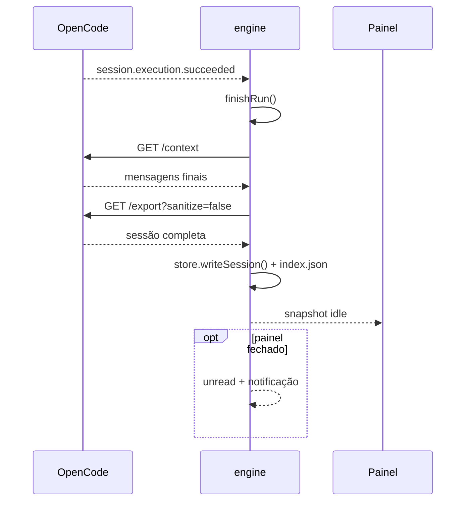

# Eventos SSE

O engine assina `GET /api/event` e aplica os eventos ao estado da conversa. Este documento lista o envelope, os eventos tratados e o efeito de cada um no snapshot.

## Envelope

```json
{
  "id": "evt_...",
  "created": 1792625451332,
  "type": "session.text.delta",
  "location": { "directory": "/home/usuario/.msbos-ai-chat" },
  "data": {
    "sessionID": "ses_...",
    "assistantMessageID": "msg_...",
    "delta": "..."
  }
}
```

O parser:

1. Lê linha a linha via `noctalia.httpStream`.
2. Ignora linhas vazias e comentários (`: heartbeat`).
3. Para linhas `data: {...}`, decodifica o JSON.
4. Usa `event.type` e `event.data`.
5. Filtra eventos de sessão por `data.sessionID == activeSession.id`.

> Exceção: `form.created` pode trazer o `sessionID` em `data.form.sessionID`. O engine trata formulários **antes** do filtro de sessão.

## Eventos tratados

| Evento | Campos usados | Efeito |
|---|---|---|
| `server.connected` | — | `status = "idle"` e publica. |
| `session.created` | `sessionID`, `title`, `model`, `agent` | Adiciona a sessão se ainda não existir. |
| `session.renamed` | `sessionID`, `title` | Atualiza título na lista e na sessão ativa. |
| `session.updated` | `sessionID`, `info.title`, `info.model`, `info.agent` | Atualiza metadados da sessão. |
| `form.created` | `data.form` (ou `data`) | Adiciona formulário pendente se for da sessão ativa; notifica se o painel estiver fechado. |
| `form.replied` | `id` ou `form.id` | Remove o formulário pendente. |
| `form.cancelled` | `id` ou `form.id` | Remove o formulário pendente. |
| `session.step.started` | `sessionID` | Marca `busy`/`runActive` se ainda não estiver rodando. |
| `session.execution.started` | `sessionID` | Idem. |
| `session.text.started` | `assistantMessageID` | Cria/reutiliza a mensagem do assistente com `streaming = true`. |
| `session.text.delta` | `assistantMessageID`, `delta` | Acrescenta texto ao assistente. |
| `session.text.ended` | `assistantMessageID`, `text` | Consolida o texto final e encerra o streaming. |
| `session.reasoning.delta` | `assistantMessageID`, `delta` | Acrescenta raciocínio. |
| `session.reasoning.ended` | `assistantMessageID`, `text` | Consolida o raciocínio. |
| `session.tool.input.started` | `id`, `name` | Guarda o nome da ferramenta para o próximo `tool.called`. |
| `session.tool.called` | `assistantMessageID`, `id`, `input` | Cria/atualiza o cartão da ferramenta como `running`. |
| `session.tool.progress` | `id`, `metadata` | Atualiza metadados do cartão. |
| `session.tool.success` | `assistantMessageID`, `id`, `input`, `content`, `metadata` | Marca `ok` e extrai o texto de `content`. |
| `session.tool.failed` | `assistantMessageID`, `id`, `error`, `content` | Marca `error` e extrai a mensagem. |
| `session.retry.scheduled` | `attempt`, `message` | `busy = true`; publica aviso “Tentando novamente…”. |
| `session.execution.succeeded` | `sessionID` | Finaliza a execução com sucesso. |
| `session.execution.failed` | `sessionID` | Define erro e finaliza. |
| `session.execution.interrupted` | `sessionID` | Finaliza sem erro adicional. |
| `session.step.ended` | `finish` | Se `finish != "tool-calls"`, finaliza a execução. |
| `session.status` | `status.type` | Se `idle`, finaliza a execução. |
| `session.error` | `error` | Associa o erro à última mensagem do assistente e finaliza. |
| `permission.asked` | `id`, `action` | Responde automaticamente: `shell`/`edit`/`question`/`form` → `once`; demais → `reject`. |
| `permission.replied` | `requestID` ou `id` | Remove a permissão pendente, se houver. |

Eventos desconhecidos são ignorados.

## Finalização de uma execução

`finishRun()` só age se `runActive` estiver ligado. Quando chamado:

1. `runActive = false`, `busy = false`.
2. `status = "idle"` ou `"error"` conforme `errorMessage`.
3. `refreshContext(activeSession.id)` — busca `/context` e substitui as mensagens.
4. `exportSession(activeSession.id)` — se `auto_export` estiver ligado.
5. `unread = not panelOpen`.
6. Se `notify_on_finish` e o painel estiver fechado, envia notificação.
7. Publica o snapshot.



## Streaming e publicação

- Deltas não publicam imediatamente; marcam `dirty`.
- `update()` roda a cada 100 ms e publica se passaram pelo menos 250 ms desde o último publish.
- O painel recebe o snapshot por `noctalia.state.watch` e re-renderiza.
- O `revision` incrementa a cada publicação; o painel não depende dele para decidir o que renderizar.

## Formulários e a ferramenta `question`

A ferramenta `question` cria um formulário com uma pergunta por campo:

```json
{
  "title": "Questions",
  "fields": [
    {
      "key": "q0",
      "title": "Qual opção?",
      "description": "Escolha uma das opções.",
      "type": "string",
      "options": [
        { "value": "A", "label": "A", "description": "Primeira opção" }
      ],
      "custom": true
    }
  ]
}
```

O evento observado é `form.created` com o formulário em `data.form`. O painel:

- cria um rascunho por `form.id`;
- aplica `field.default` quando existir;
- mostra opções selecionáveis;
- envia `IPC reply_form` com `{ formID, answer }`;
- o engine chama `POST /api/session/{id}/form/{formID}/reply`.

Enquanto o formulário está pendente, ele aparece no fim da conversa. Se o painel estiver fechado, o engine notifica “O agente precisa de uma resposta.”

## Permissões

`permission.asked` **não** cria um cartão no painel. O engine responde imediatamente:

```lua
local allowed = action == "shell" or action == "edit" or action == "question" or action == "form"
local decision = allowed and "once" or "reject"
```

Se a ação for recusada, o engine registra no log e notifica “Ação sensível bloqueada automaticamente”.

## Reconexão e eventos perdidos

O SSE não usa `Last-Event-ID` e não faz replay. Se a conexão cair:

- o engine agenda reconexão com backoff de 1 a 30 s;
- eventos ocorridos durante a queda não são reaplicados;
- ao selecionar uma sessão ou ao final da execução, `/context` reconcilia as mensagens;
- se o estado estiver `offline`, o `ensureService`/sonda de recuperação recarrega sessões/contexto.

Para forçar uma leitura nova, o usuário pode abrir o seletor e reabrir a sessão (`select_session`), ou enviar `refresh_sessions`; `sync` apenas republica o estado atual.

## Como adicionar um evento

1. Adicione o `elseif eventType == "..."` em `handleEvent` (`engine.luau`).
2. Respeite a ordem: eventos de formulário antes do filtro de sessão.
3. Atualize `publish()`/`schedulePublish()`.
4. Documente o evento aqui e o efeito no snapshot.
5. Teste com o painel aberto, recarregue o plugin e confira o log.
