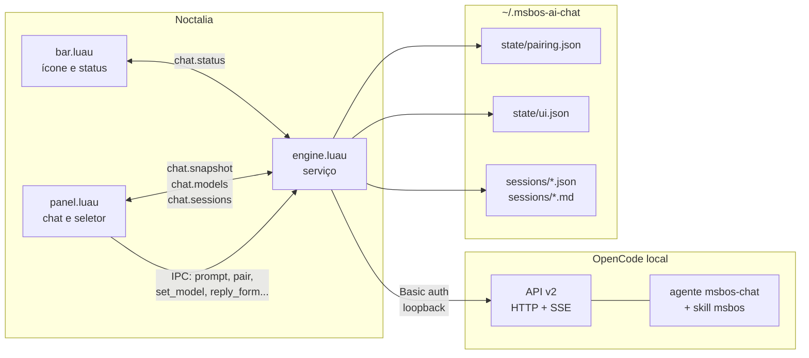

# Documentação — msbos AI Chat

Documentação técnica do plugin de chat do Noctalia que usa o OpenCode local como motor.

**Versão do plugin:** `0.2.0`
**Ambiente de referência:** Fedora 44, niri, Noctalia 5.3.0, plugin API 34, OpenCode 2.1.4
**Atualizado em:** 2026-10-23

> Esta documentação descreve o **código atual** em `plugin/` e `opencode/`.
> O [`MAPEAMENTO.md`](../MAPEAMENTO.md) registra o levantamento e as decisões iniciais; algumas partes dele foram superadas pela implementação (por exemplo, o seletor está dentro de `panel.luau` e o cliente SSE está em `lib/api.luau`).

## Comece por aqui

| Documento | Para quê |
|---|---|
| [README](../README.md) | Visão geral, requisitos, instalação e uso. |
| [AGENTS.md](../AGENTS.md) | Comandos, arquitetura e convenções para agentes. |
| [Arquitetura](arquitetura.md) | Componentes, fluxos, ciclo de vida e decisões de alto nível. |
| [Conexão com o OpenCode](conexao.md) | Pareamento, autenticação, sonda, SSE e reconexão. |
| [Interface do painel](interface.md) | Telas, seletor de modelo/sessão, formulários, compositor e tamanhos. |
| [Desenvolvimento](desenvolvimento.md) | Rodar, instalar, lint, recarregar e testar manualmente. |

## Referência

| Documento | Conteúdo |
|---|---|
| [API do OpenCode](api-opencode.md) | Endpoints, corpos, respostas e códigos usados pelo plugin. |
| [Eventos SSE](eventos.md) | Envelope, tipos de evento e efeito no estado da conversa. |
| [Componentes e módulos](componentes.md) | Arquivos, responsabilidades, funções e IPC. |
| [Configuração](configuracao.md) | Settings do plugin, manifesto, variáveis e arquivos de configuração. |
| [Estado e persistência](estado.md) | `chat.*`, `pairing.json`, `ui.json`, exports e formatos. |
| [Segurança](seguranca.md) | Token, permissões do agente, confirmação e riscos atuais. |
| [Erros e diagnóstico](erros.md) | Estados, mensagens, causas e comandos de diagnóstico. |

## Decisões arquiteturais (ADRs)

| ADR | Decisão |
|---|---|
| [0001](adr/0001-plugin-noctalia-em-vez-de-app.md) | Plugin do Noctalia em vez de um app separado. |
| [0002](adr/0002-servico-como-fonte-de-verdade.md) | O serviço `engine` é a fonte de verdade; o painel é uma view. |
| [0003](adr/0003-painel-transparente-e-tamanho-por-manifesto.md) | Fundo desenhado pelo host e tamanho aplicado via `plugin.toml`. |
| [0004](adr/0004-permissoes-automaticas-e-formularios.md) | Permissões `shell`/`edit` automáticas e formulários para decisões. |
| [0005](adr/0005-modelo-e-variante-em-novos-chats.md) | Modelo e variante propagados para novas conversas. |
| [0006](adr/0006-fundo-preto-fixo-do-chat.md) | Fundo preto fixo translúcido no painel do chat (revisa o fundo do ADR 0003). |

## Mapa em uma página

## O que esta documentação cobre

- O plugin do Noctalia (barra, painel, serviço, manifesto e traduções).
- O agente `msbos-chat` e sua relação com a skill `msbos`.
- Pareamento, autenticação, escopo por diretório, SSE e reconciliação.
- Formato do estado compartilhado, arquivos persistidos e exports.
- Segurança, limitações conhecidas e diagnóstico de falhas.

## O que não está incluído na v1

- Anexos de imagem/arquivo no compositor.
- Múltiplos painéis de chat simultâneos.
- Editor de diff embutido.
- Aprovação técnica de `shell`/`edit` por cartão no painel (o comportamento atual é automático; veja [Segurança](seguranca.md)).
- Resposta livre (“custom”) nos formulários da ferramenta `question`.
- Testes automatizados ou pipeline de CI.
