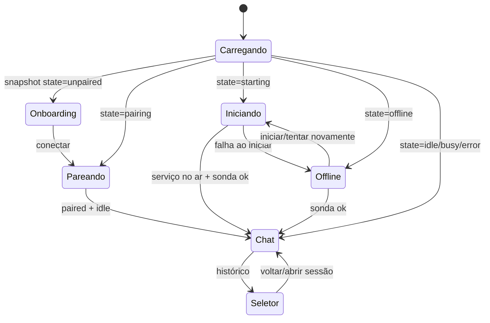

# Interface do painel

## Janela

| Propriedade | Valor |
|---|---|
| Entrada | `plugin/panel.luau` |
| Tipo | Painel flutuante do Noctalia |
| Posição | `top_right` |
| Camada | `overlay` |
| `persistent` | `false` |
| `dismiss_on_outside_click` | `false` |
| `open_near_click` | `false` |
| `keyboard_focus` | `on_demand` |
| Tamanho padrão | 460 × 640 |
| Fundo | Preto fixo translúcido desenhado pelo plugin, cobrindo o painel inteiro (inclusive a borda do tema); a intensidade vem do setting `background_opacity`. |

O `frame()` do `panel.luau` pinta o painel inteiro com um fundo **preto fixo translúcido** (`fill = "#000000"` com o alfa de `background_opacity`, `radius = 12`). O preto **não** segue a cor de superfície do tema — é uma exceção pedida pelo usuário —, e o alfa (padrão 45) mantém a transparência e o blur do sistema visíveis através dele. Como o host inseta o conteúdo do plugin em `Style::panelPadding` (14 px), o frame usa um padding negativo de 14 px para o preto alcançar a borda/raio do painel e cobri-los; um segundo container com padding de 14 px devolve o conteúdo à posição original. A borda, o raio e a sombra do painel continuam vindo do host (a borda fica escondida atrás do preto). Ver [ADR 0006](adr/0006-fundo-preto-fixo-do-chat.md).

## Ciclo de vida

- **Abrir:** `onOpen` define `chat.panel_open = true`, liga `panel.setWantsSecondTicks(true)` e `panel.setNeedsFrameTick(true)`, pede `sync` e renderiza.
- **Fechar/minimizar:** `onClose` define `chat.panel_open = false` e desliga os ticks. O serviço continua rodando.
- **Spinner:** `onFrameTick` avança `◐ ◓ ◑ ◒` a cada ~400 ms quando o estado é `busy` e a view é o chat.
- **Atualização:** o painel observa `chat.snapshot`, `chat.models` e `chat.sessions`; `update()` limpa toasts após 5 s.
- **Sem conta de IA:** quando `chat.models` está vazio, o estado vazio e o seletor mostram o cartão **“Falta conectar uma conta de IA”** (com **Conectar conta**, que abre `opencode auth login` num terminal, e **Já conectei**, que pede `sync`) em vez de um select desabilitado.

## Máquina de views



A view `picker` é local ao painel (não é um painel separado). O comando `open_picker` também pode ser enviado por IPC.

## Tela de chat

```text
┌──────────────────────────────────────────────┐
│ [ícone] msbos IA   agente: …   modelo: …     │
│ título da sessão        [+][histórico][−]    │
├──────────────────────────────────────────────┤
│ Você                                         │
│ ┌──────────────────────────────────────────┐ │
│ │ mensagem                                 │ │
│ └──────────────────────────────────────────┘ │
│ Assistente                                   │
│ [raciocínio ▾]                               │
│ texto em markdown                            │
│ ┌─ tool: read ────────────────────────────┐ │
│ │ status, entrada e resultado (expansível) │ │
│ └──────────────────────────────────────────┘ │
│ ┌─ formulário / pergunta ─────────────────┐ │
│ │ opções + responder                     │ │
│ └──────────────────────────────────────────┘ │
├──────────────────────────────────────────────┤
│ [ Pergunte sobre o sistema…       ] [enviar] │
└──────────────────────────────────────────────┘
```

### Header

- Glifo `message-chatbot` e título “msbos IA”.
- Clicar na linha do título abre o seletor (modelos/sessões). Nela, `agente: <id>   modelo: <provider/id · variante>` (`snapshot.session` via `format.modelLabel`); mostra “modelo padrão” quando não há modelo. Trunca com `maxLines = 1`.
- Subtítulo: “executando…”, título da sessão, “não pareado”, “iniciando…”, “offline” ou “pronto”.
- **+** — nova conversa.
- **Histórico** — abre o seletor.
- **−** — minimiza/fecha o painel.

### Mensagens

| Elemento | Renderização |
|---|---|
| Usuário | Coluna com `fill = primary/0.12`, label “Você” e markdown. |
| Assistente | Glifo `sparkles`, texto em markdown, “…” enquanto streaming, horário relativo e botões **Regenerar** (na última resposta; reenvia o último pedido) e **copiar**. |
| Raciocínio | Botão ghost “Raciocínio”/“Ocultar raciocínio” + markdown quando expandido. |
| Ferramenta | Cartão com glifo, nome, status, seta de expansão; entrada e saída truncadas. |
| Permissão | Cartão `tertiary/0.10` (glifo `shield-lock` + ação + alvo em **bloco de código**, com “Ver o alvo completo”) e **Permitir uma vez** / **Permitir sempre** (`ghost`) / **Recusar**; resposta por IPC `reply_permission`. |
| Erro | Label em `error`. |

O cartão de ferramenta usa `surface_variant/0.16`, borda `outline/0.30` e radius 8. O resultado exibido vem do snapshot, truncado em `MAX_SNAPSHOT_TOOL_OUTPUT` (2000) caracteres; a entrada em 1200.

O snapshot publica as últimas `MAX_SNAPSHOT_MESSAGES` (24) mensagens; quando há mais, aparece “Mostrando as últimas N de M mensagens” com o botão **Carregar anteriores** (IPC `load_previous`, que amplia a janela).

### Compositor

- `ui.input` de 1 linha, `submitOnEnter = true`, `controlSize = "sm"` (32 px, mesma altura do botão), `frameVisible = false`, foco ao abrir. **Enter** envia.
- O rascunho fica em `draft`; a `key` do input muda após envio para limpar o campo.
- **Enter** envia; o botão de enviar também.
- Durante `busy`, o botão vira **Parar** (`player-stop`, `destructive`).
- Ação (enviar/parar) fica **na mesma linha** do input, à direita (`ui.row` com o input em `flexGrow = 1`); sem texto de `agente`/`modelo` (migraram para o header).
- Sem anexos de arquivo/imagem nesta versão.

### Estados vazios e avisos

- Sem mensagens: cartão com “Pergunte sobre o seu sistema” e exemplos.
- `snapshot.notice`: aviso em `primary` (ex.: retry).
- `snapshot.error`: erro em `error`.
- `agentStatus == "missing"`: cartão vermelho “Agente msbos-chat indisponível” com **Verificar novamente** (IPC `refresh_agents`); o engine revalida sozinho com backoff. Não aparece durante `busy`; `unknown` (erro de rede) não mostra cartão.
- Toast de falha de IPC: label de erro por 5 s.

## Seletor de modelo e sessões

Aberto pelo botão **Histórico** ou por `open_picker`.

### Modelo

- `ui.select` com `models` publicados pelo engine.
- Label: `nome · providerID` (ou `nome`).
- Sem modelos: select desabilitado com “Nenhum modelo carregado”.
- Ao trocar, o painel envia `set_model` imediatamente.
- Se o modelo novo tiver a mesma variante selecionada, ela é preservada; senão volta para `default`.

### Raciocínio

- Só aparece quando o modelo selecionado tem `variants`.
- Opções: `default` + IDs crus das variantes (`low`, `high`, `max` etc.).
- `default` não é enviado no payload; o campo `variant` é omitido.
- A seleção também envia `set_model` imediatamente.

### Sessões

Há um campo **Buscar sessão…** e as sessões são agrupadas por data (**Hoje**, **Ontem**, **Últimos 7 dias**, **Mais antigas**). Cada linha tem título + tempo relativo e um botão de lixeira.

| Estado | Aparência |
|---|---|
| Selecionada | `fill = primary`, texto `on_primary`, sem borda. |
| Não selecionada | `fill = surface_variant/0.35`, texto `on_surface`, borda `outline/0.2`. |

Clicar na linha abre a sessão (`select_session`) e volta ao chat. A lixeira abre a confirmação “Apagar …?”; **Sim, apagar** remove no OpenCode, mas **não** apaga o espelho local em `sessions/`. Depois de apagar a sessão ativa, o painel permanece no seletor e **não** abre a primeira sessão; a sessão ativa fica vazia até você escolher outra ou criar uma nova.

O rodapé do seletor tem:

- **Posição e tamanho do painel** (ghost; abre Settings);
- **Apagar sessão** (`destructive`) com confirmação inline, quando há uma sessão selecionada.

### Nova conversa

**+** no header envia `new_session` com o modelo da sessão atual. O engine também usa `preferredModel`/sessão ativa como fallback. A conversa nasce com o mesmo agente configurado e a variante preservada.

## Formulários e `question`

Formulários pendentes aparecem no fim da conversa, dentro de um cartão `primary/0.06` com borda `primary/0.35`.

| Tipo de campo | UI |
|---|---|
| `boolean` | Label + toggle. |
| `string` com `options` | Cartões de seleção única. |
| `multiselect` | Cartões alternáveis. |
| Outros (`number`, `integer`, `string` sem opções, `external`) | `ui.input` de texto. |

Opções selecionadas usam `primary`; não selecionadas usam `surface_variant/0.35` com borda `outline/0.2`.

O botão **Responder** envia `reply_form` com `{ formID, answer }`. O rascunho é apagado após o envio.

Limitações atuais:

- `custom = true` não cria a opção “digite sua própria resposta”; o painel só mostra as opções listadas.
- `when` (campos condicionais), `hidden`, `required` e validação de formato não são implementados.
- `external` não tem renderização dedicada; cai no input de texto.
- O formulário só é exibido para a sessão ativa.

## Onboarding, offline e pareamento

### Onboarding (`unpaired`)

- Texto explicando o OpenCode local.
- **Conectar automaticamente**.
- Input para colar o link `http://.../auth/connect/...` (largura 380, altura 38).
- **Usar link colado** e **Colar da área de transferência**.
- **Copiar comando** (`opencode pair`) e **Tentar novamente**.
- Erro de pareamento, se houver.

### Iniciando (`starting`)

- Glifo loader e texto “Iniciando o OpenCode…”.
- Aparece no boot enquanto o engine executa `opencode service status/start`; não tem botões.

### Offline (`offline`)

- “OpenCode offline”; o engine tenta iniciar o servidor sozinho com backoff de 5 s a 60 s.
- **Iniciar OpenCode** (IPC `start`, força `service status/start` + sonda).
- **Tentar novamente** (IPC `sync`, que chama `ensureService` quando offline).
- **Abrir terminal**, que roda `opencode serve` em primeiro plano (o terminal permanece aberto para diagnóstico).
- Erro atual, se houver.

### Pareando

- Glifo loader e texto “Pareando com o OpenCode…”.

## Tamanhos

| Preset | Dimensões | Setting |
|---|---|---|
| Compacto | 420 × 560 | `compact` |
| Médio | 460 × 640 | `medium` |
| Grande | 620 × 820 | `large` |

O host é dono do tamanho. O engine executa `scripts/panel-size.sh` com o preset escolhido; o script lê o `plugin.toml` **instalado**, compara, grava `plugin.toml.bak-size` e reescreve `width`/`height` (ou sai sem tocar no arquivo). O engine então recarrega o plugin. A escrita fica fora do callback Luau porque ler+reescrever o manifesto dentro de `onConfigChanged`/`update` estourava o orçamento de CPU do host. O manifesto do repositório continua com o padrão 460 × 640; a escolha do usuário vive na cópia instalada.

Se o host não aplicar o novo tamanho, confira o `plugin.toml` instalado e recarregue o plugin manualmente.

## Cores e tema

- O painel usa os roles do tema do Noctalia (`primary`, `on_primary`, `on_surface`, `on_surface_variant`, `surface_variant`, `outline`, `error`, `tertiary`).
- Não há tema claro/escuro próprio.
- O fundo do painel é preto fixo (`#000000` com alfa de `background_opacity`), fora do tema; os cards internos usam `surface_variant` com alfa.
- A seleção de sessões/opções segue o padrão: selecionado `primary`, não selecionado translúcido.

## Teclado e foco

- `keyboard_focus = "on_demand"`: o painel não rouba o foco ao abrir.
- O compositor usa `focus = true` e `submitOnEnter`.
- **Enter** envia; o input é de 1 linha.
- Não há captura global de teclas nem atalho próprio; o widget da barra é o ponto de abertura.
