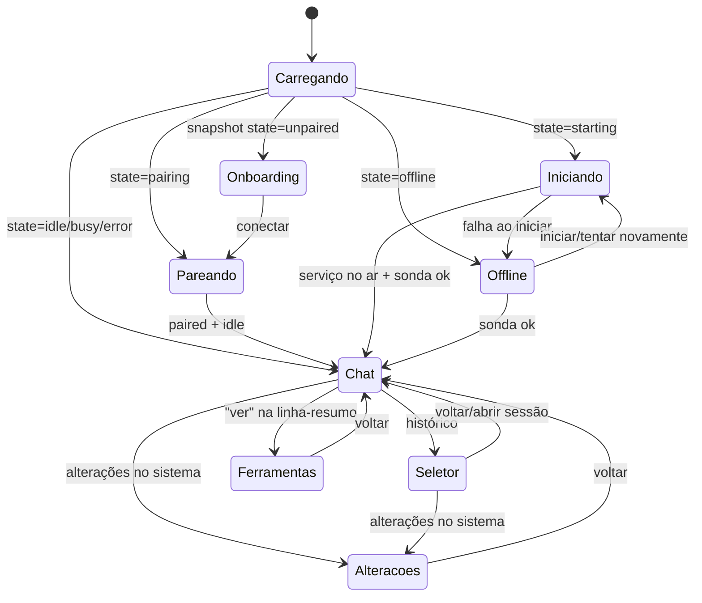

# Interface do painel

## Janela

| Propriedade | Valor |
|---|---|
| Entrada | `plugin/panel.luau` |
| Tipo | Painel flutuante do Noctalia |
| Posição | `top_right` |
| Camada | `overlay` |
| `persistent` | `false` |
| `dismiss_on_outside_click` | `false` |
| `open_near_click` | `false` |
| `keyboard_focus` | `on_demand` |
| Tamanho padrão | 460 × 640 |
| Fundo | Preto fixo translúcido desenhado pelo plugin, cobrindo o painel inteiro (inclusive a borda do tema); a intensidade vem do setting `background_opacity`. |

O `frame()` do `panel.luau` pinta o painel inteiro com um fundo **preto fixo translúcido** (`fill = "#000000"` com o alfa de `background_opacity`, `radius = 12`). O preto **não** segue a cor de superfície do tema — é uma exceção pedida pelo usuário —, e o alfa (padrão 45) mantém a transparência e o blur do sistema visíveis através dele. Como o host inseta o conteúdo do plugin em `Style::panelPadding` (14 px), o frame usa um padding negativo de 14 px para o preto alcançar a borda/raio do painel e cobri-los; um segundo container com padding de 14 px devolve o conteúdo à posição original. A borda, o raio e a sombra do painel continuam vindo do host (a borda fica escondida atrás do preto). Ver [ADR 0006](adr/0006-fundo-preto-fixo-do-chat.md).

## Ciclo de vida

- **Abrir:** `onOpen` define `chat.panel_open = true`, liga `panel.setWantsSecondTicks(true)` e `panel.setNeedsFrameTick(true)`, pede `sync` e renderiza.
- **Fechar/minimizar:** `onClose` define `chat.panel_open = false` e desliga os ticks. O serviço continua rodando.
- **Spinner:** `onFrameTick` avança `◐ ◓ ◑ ◒` a cada ~400 ms quando o estado é `busy` e a view é o chat; o texto vem de `format.activityLabel(snapshot)` — “Trabalhando: lendo arquivos…”, “Pensando…”, “Aguardando a sua resposta…” — seguido do tempo decorrido, a partir de `runStartedAt`.
- **Atualização:** o painel observa `chat.snapshot`, `chat.models` e `chat.sessions`; `update()` limpa toasts após 5 s.
- **Sem conta de IA:** quando `chat.models` está vazio, o estado vazio e o seletor mostram o cartão **“Falta conectar uma conta de IA”** (com **Conectar conta**, que abre `opencode auth login` num terminal, e **Já conectei**, que pede `refresh_models`) em vez de um select desabilitado.

## Máquina de views



A view `picker` é local ao painel (não é um painel separado). O comando `open_picker` também pode ser enviado por IPC.

## Tela de chat

```text
┌──────────────────────────────────────────────┐
│ [ícone] msbos IA   agente: …   modelo: …     │
│ título da sessão        [+][histórico][−]    │
├──────────────────────────────────────────────┤
│ Você                                         │
│ ┌──────────────────────────────────────────┐ │
│ │ mensagem                                 │ │
│ └──────────────────────────────────────────┘ │
│ Assistente                                   │
│ [raciocínio ▾]                               │
│ texto em markdown                            │
│ ┌─ 3 ferramentas · 1 erro → ver ───────────┐ │
│ │ resumo da execução (abre a view)         │ │
│ └──────────────────────────────────────────┘ │
│ ┌─ formulário / pergunta ─────────────────┐ │
│ │ opções + responder                     │ │
│ └──────────────────────────────────────────┘ │
├──────────────────────────────────────────────┤
│ [ Pergunte sobre o sistema…       ] [enviar] │
└──────────────────────────────────────────────┘
```

No modo `rows`/`full`, a linha-resumo dá lugar a um cartão por chamada (compacto
expansível ou completo, respectivamente). No modo `hidden`, o bloco de
raciocínio e os cartões somem: fica o texto do run e a linha-resumo (com a
primeira linha do erro, quando houver).

### Header

- Glifo `message-chatbot` e título “msbos IA”.
- Clicar na linha do título abre o seletor (modelos/sessões). Nela, `agente: <id>   modelo: <provider/id · variante>` (`snapshot.session` via `format.modelLabel`); mostra “modelo padrão” quando não há modelo. Trunca com `maxLines = 1`.
- Subtítulo: “executando…”, título da sessão, “não conectado”, “iniciando…”, “sem conexão” ou “pronto”.
- **+** — nova conversa.
- **Histórico** — abre o seletor.
- **−** — minimiza/fecha o painel.

### Mensagens

| Elemento | Renderização |
|---|---|
| Usuário | Coluna com `fill = primary/0.12`, label “Você” e markdown. |
| Assistente | Glifo `sparkles`, texto em markdown, “…” enquanto streaming, horário relativo e botões **Regenerar** (na última resposta; reenvia o último pedido) e **copiar**. |
| Raciocínio | Botão ghost “Raciocínio”/“Ocultar raciocínio” + markdown quando expandido. |
| Ferramenta | Cartão com glifo, **nome comum** (`format.toolLabel`: “Executar comando”, “Pergunta ao usuário”), **resumo do input** (`tool.summary`, ex.: `src/chat.luau`, `dnf install htop`), status, **duração** (`format.toolDuration`), seta de expansão; entrada e saída truncadas. Falha mostra a primeira linha do erro mesmo com o cartão fechado. O nome técnico fica no tooltip. |
| Execução | Linha-resumo (`surface_variant/0.10`) com glifo, `N ferramentas`, contagem de erros em `error`, **duração total** (`format.runDuration`), “ver” e chevron. Mostra a primeira linha do erro quando alguma ferramenta falhou. Clique abre a view **Ferramentas desta execução**. |
| Permissão | Cartão `tertiary/0.10` em duas camadas: primeiro o resumo em linguagem comum (“O assistente quer: Instalar o programa htop”, derivado de `action`/`resources`), com **Permitir uma vez** / **Recusar** e **Ver o comando** (bloco de código, colapsado). **Permitir sempre** fica atrás de **Mais opções**, com aviso de risco e de como voltar a exigir confirmação; resposta por IPC `reply_permission`. |
| Erro | Label em `error`. |
| Anexos | Chips com `paperclip` e `Arquivo: nome` / `Imagem: nome` abaixo do texto (na bolha do usuário e na resposta); o conteúdo binário não é publicado. |
| Falha de conexão | Banner `error/0.08` no topo do chat com título por causa, detalhe e ação: **Reconectar** (401), **Tentar novamente** (timeout/erro/stream) ou **Iniciar o assistente** (servidor fora). |
| Consumo | Rodapé do compositor: `Contexto 12.345 (6%) · Sessão US$ 0,0231` (tokens de `usage.contextUsed`, custo de `usage.cost`) e uma barra `ui.progress` de 3 px quando o modelo informa `limit.context`. Custo `0` aparece como **Sessão grátis** (modelo sem cobrança); custo ausente não aparece. |

O cartão de ferramenta usa `surface_variant/0.16`, borda `outline/0.30` e radius 8. O resultado exibido vem do snapshot, truncado em `max_tool_output` (padrão 4000, faixa 500–20000, publicado em `snapshot.limits.toolOutput`); a entrada em 1200.

### Modos de exibição das ferramentas

O setting `tool_display` decide o que aparece no chat (`onConfigChanged` relê sem recarregar o plugin):

| Modo | Comportamento |
|---|---|
| `grouped` (padrão) | Uma linha-resumo por execução; só a ferramenta em execução e a `question` ficam inline. |
| `rows` | Um cartão compacto expansível por chamada (sem agrupamento). |
| `full` | Cartão completo com entrada e saída sempre visíveis, sem seta. |
| `hidden` | Sem raciocínio e sem cartões: texto do run fundido num bloco e a linha-resumo no fim. |

Regra invariável: `question`, cartão de permissão e erro nunca são escondidos em nenhum modo.

### Diff de edição

Quando o metadata de uma ferramenta traz `diff`, o cartão expandido mostra um bloco `diff` em markdown (até 6000 caracteres) antes do resultado.

### Busca na conversa

Botão de lupa no header ou **Ctrl+F** abre um `ui.input` abaixo do header. A busca é por substring (case-insensitive) em `text`, `reasoning`, `error`, e em `name`/`summary`/`input`/`output` das ferramentas. Enquanto há texto, a lista mostra só as mensagens com ocorrência e o cabeçalho do resultado (`3 de 24 mensagens com “teste”`); as ferramentas aparecem como linhas (`rows`) em vez de agrupadas. Fechar (**X**) limpa o filtro e volta à conversa completa.

### Aviso de pendência em outra conversa

Quando uma sessão que não está aberta fica esperando permissão ou formulário, o topo do chat mostra um aviso `tertiary/0.10` com `N pedidos em outras conversas` e o botão **Abrir**, que troca de sessão (`select_session`) e exibe o cartão. Nenhuma pendência é respondida automaticamente por esse caminho.

### View “Ferramentas desta execução”

Aberta pela linha-resumo (`view = "tools"`). Mostra o cabeçalho de retorno, o total (`N ferramentas · N erros`), o filtro **Somente erros** (quando há erro) e um cartão compacto expansível por ferramenta, na ordem cronológica. Voltar (`onBackToChat`) limpa a seleção e retorna ao chat.

O snapshot publica as últimas `MAX_SNAPSHOT_MESSAGES` (24) mensagens; quando há mais, aparece “Mostrando as últimas N de M mensagens” com o botão **Carregar anteriores** (IPC `load_previous`, que amplia a janela).

### Seletor de modelo, raciocínio e agente

Além do modelo e da variante de raciocínio, o seletor mostra um `ui.select` de **Agente** quando `chat.agents` não está vazio (só agentes primários visíveis, desabilitado durante `busy`); a troca usa `set_agent` e vale para a sessão ativa. Cada linha de sessão acrescenta `· executando` ou `· nova resposta` conforme `busy`/`unread` publicados em `chat.sessions`.

### Compositor

- `ui.input` de 1 linha por padrão, `submitOnEnter = true`, `controlSize = "sm"` (32 px, mesma altura do botão), `frameVisible = false`, foco ao abrir. **Enter** envia. Com `composer_multiline = true`, vira `multiline` de 64 px: **Enter** envia e **Shift+Enter** quebra a linha.
- O rascunho é **por conversa** (`drafts[sessionID]`): trocar de sessão não apaga o texto da outra. A `key` do input muda após envio para limpar o campo.
- **Enter** envia; o botão de enviar também.
- Durante `busy`, o botão vira **Parar** (`player-stop`, `destructive`).
- Ação (enviar/parar) fica **na mesma linha** do input, à direita (`ui.row` com o input em `flexGrow = 1`); sem texto de `agente`/`modelo` (migraram para o header).
- Copiar: botão **Copiar mensagem** na bolha do usuário e **Copiar entrada**/**Copiar saída** no cartão expandido da ferramenta (além de **Copiar resposta** no cabeçalho do assistente).
- Sem anexos de arquivo/imagem nesta versão.

### Estados vazios e avisos

- Sem mensagens: cartão com “Pergunte sobre o seu sistema” e três exemplos em linguagem comum (“Deixe as janelas mais afastadas”, “Instale um programa”, “Mude as cores do desktop”), que enviam `prompt` ao clicar. Sem modelos (`chat.models` vazio), o cartão “Falta conectar uma conta de IA” substitui os exemplos.
- `snapshot.notice`: aviso em `primary` (ex.: retry).
- `snapshot.error`: erro em `error`.
- `agentStatus == "missing"`: cartão vermelho “Assistente especialista indisponível” com **Verificar novamente** (IPC `refresh_agents`) e os detalhes técnicos sob demanda; o engine revalida sozinho com backoff. Não aparece durante `busy`; `unknown` (erro de rede) não mostra cartão.
- Toast de falha de IPC: label de erro por 5 s.

## Seletor de modelo e sessões

Aberto pelo botão **Histórico** ou por `open_picker`.

### Modelo

- `ui.select` com `models` publicados pelo engine.
- Label: `nome · providerID` (ou `nome`).
- Sem modelos: select desabilitado com “Nenhum modelo carregado”.
- Ao trocar, o painel envia `set_model` imediatamente.
- Se o modelo novo tiver a mesma variante selecionada, ela é preservada; senão volta para `default`.

### Raciocínio

- Só aparece quando o modelo selecionado tem `variants`.
- Opções: `default` + IDs crus das variantes (`low`, `high`, `max` etc.).
- `default` não é enviado no payload; o campo `variant` é omitido.
- A seleção também envia `set_model` imediatamente.

### Sessões

Há um campo **Buscar sessão…** e as sessões são agrupadas por data (**Hoje**, **Ontem**, **Últimos 7 dias**, **Mais antigas**). Cada linha tem título + tempo relativo e um botão de lixeira.

| Estado | Aparência |
|---|---|
| Selecionada | `fill = primary`, texto `on_primary`, sem borda. |
| Não selecionada | `fill = surface_variant/0.35`, texto `on_surface`, borda `outline/0.2`. |

Clicar na linha abre a sessão (`select_session`) e volta ao chat. A lixeira abre a confirmação “Apagar …?”; **Sim, apagar** remove no OpenCode, mas **não** apaga o espelho local em `sessions/`. Depois de apagar a sessão ativa, o painel permanece no seletor e **não** abre a primeira sessão; a sessão ativa fica vazia até você escolher outra ou criar uma nova.

O rodapé do seletor tem:

- **Alterações no sistema** (ghost; abre a tela de alterações, IPC `open_changes`);
- **Posição e tamanho do painel** (ghost; abre Settings);
- **Apagar sessão** (`destructive`) com confirmação inline, quando há uma sessão selecionada.

### Alterações no sistema

View `changes` (IPC `open_changes`, também pelo rodapé do seletor), alimentada por `chat.changes`:

- Lista as 30 mudanças mais recentes do log da skill, da última para a primeira. Cada item mostra:
  - a data em linguagem comum (`format.changeWhen`: “hoje, 16:50”, “ontem, 15:22”, “24/10, 16:50”);
  - um **título em linguagem comum** (`format.changeTitle`), derivado da linha do log: “Instalou o programa btop”, “Trocou as cores do sistema (azul → roxo)”, “Desativou a inicialização automática do JetBrains Toolbox”, “Ajustou o espaçamento das janelas” etc. Quando o tipo não é reconhecido, cai em “Alterou o sistema”;
  - **Desfazer** (envia `prompt` pedindo a reversão — o assistente explica e passa pelo cartão de permissão) e **Ver detalhes** (mostra a linha crua do log e, quando existe, **Copiar comando de desfazer**).
- O painel não executa nada sozinho: desfazer é uma mensagem como qualquer outra.
- Estado vazio: “Nenhuma alteração registrada ainda.”.

### Nova conversa

**+** no header envia `new_session` com o modelo da sessão atual. O engine também usa `preferredModel`/sessão ativa como fallback. A conversa nasce com o mesmo agente configurado e a variante preservada.

## Formulários e `question`

Formulários pendentes aparecem no fim da conversa, dentro de um cartão `primary/0.06` com borda `primary/0.35`. O título vem de `format.formTitle` (o host manda “Questions” em inglês; o painel mostra “Pergunta”) e o subtítulo é “Escolha uma opção e confirme.”.

O agente usa esse cartão para a **aprovação** de uma mudança: pergunta curta e opções “Sim, aplicar” / “Não, cancelar” (instrução no `msbos-chat.md` e na skill).

| Tipo de campo | UI |
|---|---|
| `boolean` | Label + toggle. |
| `string` com `options` | Cartões de seleção única. |
| `multiselect` | Cartões alternáveis. |
| Outros (`number`, `integer`, `string` sem opções, `external`) | `ui.input` de texto. |

Opções selecionadas usam `primary`; não selecionadas usam `surface_variant/0.35` com borda `outline/0.2`.

O botão **Responder** envia `reply_form` com `{ formID, answer }`. O rascunho é apagado após o envio.

Limitações atuais:

- `custom = true` não cria a opção “digite sua própria resposta”; o painel só mostra as opções listadas.
- `when` (campos condicionais), `hidden`, `required` e validação de formato não são implementados.
- `external` não tem renderização dedicada; cai no input de texto.
- O formulário só é exibido para a sessão ativa.

## Onboarding, offline e pareamento

### Onboarding (`unpaired`)

- Texto explicando o OpenCode local.
- **Conectar agora**.
- Input para colar o link `http://.../auth/connect/...` (largura 380, altura 38).
- **Usar link colado** e **Colar da área de transferência**.
- **Copiar comando** (`opencode pair`) e **Tentar novamente**.
- Erro de pareamento, se houver.

### Iniciando (`starting`)

- Glifo loader e texto “Iniciando o OpenCode…”.
- Aparece no boot enquanto o engine executa `opencode service status/start`; não tem botões.

### Offline (`offline`)

- “Assistente sem resposta”; o engine tenta iniciar o servidor sozinho com backoff de 5 s a 60 s.
- **Iniciar assistente** (IPC `start`, força `service status/start` + sonda).
- **Tentar novamente** (IPC `sync`, que chama `ensureService` quando offline).
- **Abrir terminal**, que roda `opencode serve` em primeiro plano (o terminal permanece aberto para diagnóstico).
- Erro atual, se houver.

### Pareando

- Glifo loader e texto “Pareando com o OpenCode…”.

## Tamanhos

| Preset | Dimensões | Setting |
|---|---|---|
| Compacto | 420 × 560 | `compact` |
| Médio | 460 × 640 | `medium` |
| Grande | 620 × 820 | `large` |

O host é dono do tamanho. O engine executa `scripts/panel-size.sh` com o preset escolhido; o script lê o `plugin.toml` **instalado**, compara, grava `plugin.toml.bak-size` e reescreve `width`/`height` (ou sai sem tocar no arquivo). O engine então recarrega o plugin. A escrita fica fora do callback Luau porque ler+reescrever o manifesto dentro de `onConfigChanged`/`update` estourava o orçamento de CPU do host. O manifesto do repositório continua com o padrão 460 × 640; a escolha do usuário vive na cópia instalada.

Se o host não aplicar o novo tamanho, confira o `plugin.toml` instalado e recarregue o plugin manualmente.

## Cores e tema

- O painel usa os roles do tema do Noctalia (`primary`, `on_primary`, `on_surface`, `on_surface_variant`, `surface_variant`, `outline`, `error`, `tertiary`).
- Não há tema claro/escuro próprio.
- O fundo do painel é preto fixo (`#000000` com alfa de `background_opacity`), fora do tema; os cards internos usam `surface_variant` com alfa.
- A seleção de sessões/opções segue o padrão: selecionado `primary`, não selecionado translúcido.

## Teclado e foco

- `keyboard_focus = "on_demand"`: o painel não rouba o foco ao abrir.
- O compositor usa `focus = true` e `submitOnEnter`.
- **Enter** envia; o input é de 1 linha (ou 64 px com `composer_multiline`).
- `capture_keys = ["ctrl+n", "ctrl+k", "ctrl+f", "ctrl+shift+c"]` no `[[panel]]`; `onKey(chord, pressed)` trata: **Ctrl+N** nova conversa, **Ctrl+K** modelos/sessões, **Ctrl+F** buscar na conversa, **Ctrl+Shift+C** copiar a última resposta. Escape sempre fecha. Input focado tem prioridade para texto.
